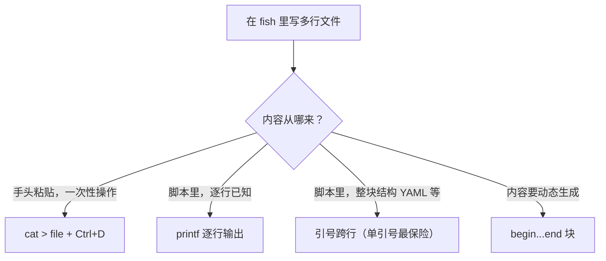

从 bash 换到 fish 的人，几乎都会撞上同一堵墙：想用熟悉的 `cat <<EOF` 写一个多行文件，fish 劈头就是一个语法错误。这不是你写错了，也不是版本旧了——**fish 从设计上就不支持 heredoc**，到今天（4.9.3）依然如此。本文讲清楚它为什么没有、三个最容易踩的误区，以及四种经过实测的替代写法。

<!--more-->

先看现场——下面所有命令与输出，均实测于 fish 4.9.3：

```console
$ cat > config.yaml <<EOF
fish: Expected a string, but found a redirection
cat > config.yaml <<EOF
                   ^
```

报错指向 `<<`。这篇文章要做的，就是把你从"我哪里写错了"引到"fish 本来就不打算这么做"，再给出它希望你用的写法。

## 一、先给结论

| 问题 | 答案 |
|------|------|
| fish 支持 `cat <<EOF` 这类 heredoc 吗？ | **不支持**。从 2013 年至今所有版本都不支持，而且这是**设计决定**，不是没排期 |
| 那个报错是什么意思？ | `<<` 在 fish 里不是 heredoc 的开头，被解析器当成重定向处理 |
| 那多行文件怎么写？ | 交互式用 `cat > file` + Ctrl+D；脚本里用 printf / 引号跨行 / `begin...end` 块 |

## 二、为什么 fish 故意没有 heredoc

fish 官方文档里有个专门的页面叫 “Fish for Bash users”（给 bash 用户的迁移指南），其中 Heredocs 一节的第一句话就是：

> fish does not have `<<EOF` “heredocs”.

官方不光说"没有"，还给出了完整的设计理由。heredoc 实际做的事情是三步：按特殊规则读取一段字符串 → 写入临时文件 → 把这个文件挂到命令的标准输入上。也就是说，它**本质上等价于从管道读取**：

```fish
echo "foo" | cat
```

效果和 bash 里的

```bash
cat <<EOF
foo
EOF
```

几乎相同。文档原话是：heredoc 只是“引入了大量特殊规则的语法糖”，所以 fish 不做它——“管道才是核心概念，更简单，组合起来也更漂亮”（Pipes are a core concept, and are simpler and compose nicer）。

这个决定有多坚定？GitHub 上关于它的功能请求是 **issue #540：2013 年提出，2016 年被官方以设计理由关闭**——不是"以后再考虑"，是明确不做。

> **所以不要等新版 fish "支持 heredoc"。这不是排期问题，是产品哲学问题——像等待 vim 支持鼠标右键菜单一样没有尽头。**

理解这一点之后，后面的替代写法就不再是"变通"，而是"用 fish 希望的方式解决同一个问题"。

## 三、三个最容易踩的误区

### 误区一：“新版 fish 已经支持 heredoc 了”

网上（包括一些 AI 回答、教程和搜索摘要）偶尔能看到“fish 3.4.0+ / 4.x 起支持 heredoc”的说法——**不存在任何这样的版本**。fish 3.4.0 的真实新增特性是 `$(cmd)` 命令替换语法；4.0 是核心重写（换用 Rust），同样没有引入 heredoc。

这类错误说法最迷惑人的地方，是它带着版本号，看起来像查证过。验证方法只要 5 秒：

```console
$ fish --version
fish, version 4.9.3
$ cat <<EOF
fish: Expected a string, but found a redirection
```

**让 shell 自己回答，永远比任何二手资料可靠。**

### 误区二：把 bash heredoc 的“变体规则”搬过来

bash 用户对 heredoc 积攒了一套细节经验：`<<-EOF` 忽略行首 Tab、`<<'EOF'` 禁止变量展开、结束符必须顶格……在 fish 里这些讨论全部落空——**整个 heredoc 语法都不存在**，谈不上任何变体。你不需要记住“结束符要不要顶格”，只需要换一种写法（见第四节）。

### 误区三：cat 配多行字符串——最迷惑人的报错

由于 fish 的引号本身就能跨行（官方文档原话：Quotes are followed across newlines），有人会自然地把 heredoc 的思路平移过来，让 `cat` 去“承接”一段多行字符串：

```console
$ cat > config.yaml "root:
    child: 1"
cat: $'root:\n    child: 1': No such file or directory
```

这个报错之所以迷惑，在于两层：

1. **文件被创建了，但是空的**。因为 `> config.yaml` 这条重定向是 shell 先执行的——目标文件已经建立，随后 `cat` 才失败。你会看到一个 0 字节的 `config.yaml`，误以为“就快成了”；
2. **cat 在找一个“名字很长的文件”**。`cat` 的参数从来是**文件名**，不是内容。你把整段内容写成了“要打开的文件名”，它当然找不到。

所以"引号跨行"这个能力本身没问题——它是官方支持的特性；**问题出在搭配的命令**。跨行引号要交给 `echo`、`printf` 这类“把参数原样输出”的命令，再配合重定向落盘。

## 四、四种正确写法（全部实测）

### 方法一：交互式 `cat > file` + Ctrl+D（最接近 heredoc 的体验）

```console
$ cat > config.yaml
apiVersion: v1
kind: ConfigMap
metadata:
  name: app-config
^D
```

- 敲完 `cat > config.yaml` 回车，终端进入“等待输入”状态，你可以逐行输入，也可以直接粘贴整段内容；
- 内容完成后，**在新行行首按 Ctrl+D**（发送 EOF，即“输入到此为止”），内容立即写盘；
- 这个行为 fish 和 bash 完全一致——**它是最接近 heredoc 心智的操作路径**，唯一缺点是没法写进脚本、难以自动化。

### 方法二：printf——脚本里最稳

```fish
printf '%s\n' \
    'apiVersion: v1' \
    'kind: ConfigMap' \
    'metadata:' \
    '  name: app-config' \
    > config.yaml
```

- `'%s\n'` 格式串表示“每个参数输出一行、行尾补换行”，行内容逐项列出，一目了然；行尾的反斜杠是 fish 的续行，方便排版；
- 内容含**单引号**时有两种处理：fish 允许在单引号内用 `\'` 转义（这是 fish 相对 POSIX 的便利），或者把该参数换成双引号包裹（注意双引号内 `$` 会展开）：

  ```fish
  printf '%s\n' 'note: it\'s fine'    # 单引号内用 \' 转义
  printf '%s\n' "note: it's fine"     # 或整体换双引号
  ```

- 优点：每行都是独立参数，行为完全可预测，适合写进脚本；缺点：内容一长，逐行加引号比较费手。

### 方法三：引号跨行——写 YAML 最顺手

fish 的引号（单、双都算）可以跨行——这是官方文档明确支持的特性，不是 hack：

```fish
echo > config.yaml 'apiVersion: v1
kind: ConfigMap
metadata:
  name: app-config
  labels:
    app: demo'
```

三个要点：

1. **内容原样保留，包括缩进**。用 `cat -A` 查看会发现所有前导空格都进了文件——对 YAML 反而是好事（本来就靠缩进），但注意**别为了代码块美观给内容整体缩进**，那些空格会原样进文件；
2. **单引号 vs 双引号**：单引号内一切字面（`$HOME` 就是 `$HOME`）；双引号内变量和命令替换会展开。写含 `$` 的配置内容时用单引号，想做模板时用双引号（`\$` 可转义出字面 `$`）：

   ```console
   $ echo > demo.txt 'path: $HOME/nested'    # 文件内容就是 path: $HOME/nested
   $ echo > demo.txt "path: $HOME/nested"    # 文件内容变成 path: /home/you/nested
   $ echo > demo.txt "path: \$HOME/nested"   # 转义后又是字面 $HOME
   ```

3. **想让结束引号独占一行**时，用反斜杠续行（首尾的 `\` + 换行会被移除，不进入内容）——**但这条只适用于双引号**：

   ```fish
   echo > config.yaml "\
   apiVersion: v1
   kind: ConfigMap\
   "
   ```

   如果一个手滑用了单引号版本 `'\ ... \'`，反斜杠会被**字面写进文件**（单引号内反斜杠只在 `\'` 和 `\\` 时才充当转义）。单引号跨行就直接用、不需要续行符——这是两个引号家族又一处容易混淆的细节。

### 方法四：begin...end 块——内容要动态生成时

```fish
begin
    echo 'apiVersion: v1'
    echo 'kind: ConfigMap'
    echo "metadata:"
    echo "  name: app-config"
    echo "  namespace: $ns"
end > config.yaml
```

- `begin ... end` 把一组命令的**输出聚合成一个流、统一重定向**——这是 fish 独有的顺手工具；
- 块内可以用任何 fish 语法：变量、循环、条件。比如按清单动态生成配置：

  ```fish
  begin
      echo 'services:'
      for s in web api worker
          echo "  - name: $s"
      end
  end > services.yaml
  ```

- 适合“内容需要拼装”的场合；纯静态内容用它就有点重了。

### 顺带：如果只是为了“喂给命令”，可能根本不用文件

记住官方那句判断——heredoc 的本质是管道。所以如果你的目的不是落盘，而是把一段内容喂给某个命令，很多 CLI 支持从标准输入读：

```fish
printf '%s\n' 'line1' 'line2' | kubectl apply -f -
```

`-f -` 里的 `-` 表示“从 stdin 读文件内容”，这是相当多命令行工具的通用约定（kubectl、docker 等）。目标命令支持时，直接管道，一步到位。

## 五、怎么选：一张决策图



对照表：

| 方法 | 变量展开 | 内容缩进 | 适合场景 |
|------|---------|---------|---------|
| `cat > file` + Ctrl+D | 不适用（原样） | 原样保留 | 交互式、粘贴大段内容 |
| `printf '%s\n' ...` | 按引号规则 | 手动写进每行 | 脚本、逐行内容 |
| 引号跨行（单引号） | **不展开** | 原样保留 | 静态 YAML / 配置文件 |
| 引号跨行（双引号） | **展开**（`\$` 可转义） | 原样保留 | 含变量的模板 |
| `begin...end` | 块内自由控制 | 手动写进每行 | 动态生成内容 |

## 六、给 AI 助手时代的一个小提醒

heredoc 这类“小众工具事实”恰好是 AI 回答的高频幻觉区：模型对 bash 的 heredoc 规则滚瓜烂熟，很容易顺手套到 fish 上，给出带着版本号的错误答案（“3.4.0+ 已支持”听起来特别可信）。两个习惯可以避开这类坑：

1. **让 shell 自己验证**——不确定的语法直接在终端跑一次，报错信息比任何资料都权威；
2. **给 AI 明确的版本上下文**——比如贴上 `fish --version` 的输出，或直接说“用 fish 4.9.3 的语法写（它没有 heredoc），帮我把这段内容写进文件”。把约束说对，AI 的产出质量会稳定得多。

## 七、小结

| 概念 | 一句话 |
|------|--------|
| fish 与 heredoc | 设计上不支持，不是版本问题（issue #540 已被官方以设计理由关闭） |
| 报错 | `Expected a string, but found a redirection`——`<<` 不是 heredoc 的开始 |
| 官方立场 | heredoc 是语法糖，等价于管道；管道才是 fish 的核心概念 |
| 交互式 | `cat > file` + Ctrl+D（新行行首），与 bash 一致 |
| 脚本三招 | `printf '%s\n'`、引号跨行、`begin...end` |
| 不用文件 | 目标命令支持 stdin 时，直接 `... | cmd -f -` |
| 验证习惯 | 5 秒实测，胜过任何二手资料 |

最后留一个开放问题：fish 官方把 heredoc 定性为“只是引入了大量特殊规则的语法糖”——你觉得这个判断成立吗？从你自己的工作流里找一个过去用 heredoc 的真实场景，用第四节的四种方法改写一遍：如果改写后并没有变麻烦，那 fish 的取舍就说得通；如果哪个场景确实变别扭了，那正好是你摸到两种设计哲学边界的地方。欢迎来评论区聊聊你的改写体验。
