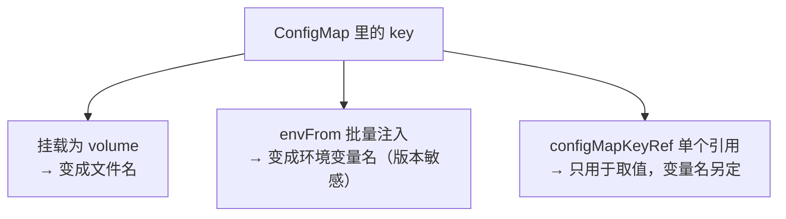
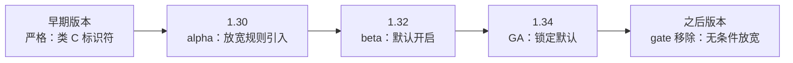

「K8s 里的 ConfigMap 是不是 key 都要大写？」——这是被问得最多的问题之一。网上最常见的答案说：key 不要求大写，但通过 `envFrom` 注入时，不符合环境变量命名规则的 key 会被跳过——比如 `app.properties`、`my-key`。

这个答案曾经完全正确。但它的后半句，已经在近几年的 K8s 版本里悄悄失效了。这篇文章把 ConfigMap key 的完整规则、三种消费方式、以及环境变量命名规则的版本演进一次讲清。

<!--more-->

## 一、先给结论

三个常被混在一起传的规则，分开看：

| 你的疑问 | 答案 |
|---|---|
| ConfigMap 的 key 必须大写吗？ | **不必须**。大写小写都行，而且大小写敏感（`LOG_LEVEL` 和 `log_level` 是两个不同的 key） |
| key 能用哪些字符？ | 字母、数字、`-`、`_`、`.`——校验就是一个正则 `[-._a-zA-Z0-9]+` |
| ConfigMap 的**名字**（`metadata.name`）呢？ | 这个**必须小写**：它必须是合法的 DNS 子域名（RFC 1123） |

"ConfigMap 必须小写"这句流传很广的话，说的其实是第三条——**名字**必须小写；**key** 从来没有过大写的要求。两个规则被揉在一起传，就变成了各种玄学。

顺带一提：`data` 和 `binaryData` 的 key 规则完全相同；Secret 的 key 也用的是同一套。

那 key 到底有什么讲究？讲究不在"大写小写"，而在 **key 被谁消费、去哪里**。

## 二、一个 key，三种去向

同一个 key，在三种消费路径下命运完全不同：



对照表：

| 消费方式 | key 的去向 | 对 key 的额外要求 |
|---|---|---|
| 挂载为 volume | 挂载目录里的**文件名** | 无（在字符集内即可）；可用 `items[].path` 重命名 |
| `envFrom` 批量注入 | **环境变量名** | 旧版本：不符合命名规则的会被跳过；现行版本：几乎不再有"非法"的 key |
| `valueFrom.configMapKeyRef` | 只取 **value** | 无——环境变量名是另外指定的 |

逐个看。

### volume：key 变成文件名

```yaml
apiVersion: v1
kind: ConfigMap
metadata:
  name: app-config        # 名字：必须小写
data:
  app.properties: |       # key：点、横线随便用
    server.port=8080
```

```yaml
# Pod 里挂载它：
volumes:
  - name: config
    configMap:
      name: app-config
# 容器里会出现文件：/etc/app/app.properties
```

key 天然变成文件名，所以"配置文件风格"的点号命名在这里最自然。要改名还有 `items[].path`：

```yaml
volumes:
  - name: config
    configMap:
      name: app-config
      items:
        - key: app.properties            # ConfigMap 里的 key
          path: application.properties   # 挂进容器后的文件名
```

### configMapKeyRef：key 只用来"查值"

```yaml
env:
  - name: APP_CONFIG          # 环境变量名：自己定，爱怎么规范怎么规范
    valueFrom:
      configMapKeyRef:
        name: app-config
        key: app.properties   # key 原样引用，不受命名规则约束
```

这是自由度最高的一条路：key 保持它本来的样子，消费端要什么名字就是什么名字——**key 与消费端命名彻底解耦**。

### envFrom：key 直接当环境变量名

```yaml
envFrom:
  - configMapRef:
      name: app-config
      # 多个 ConfigMap 时还能加前缀避免打架：
      # prefix: APP_
```

这也是问题最多的一条路——因为它曾经有条"陷阱规则"。

## 三、envFrom 的"陷阱规则"：它曾经是真的

流传最广的说法是：通过 `envFrom` 注入时，key 会被当作环境变量名，不符合环境变量命名规则的 key 会被**跳过**。

这不是谣言。K8s 官方文档里至今保留着这个例子：

```
Warning  InvalidEnvironmentVariableNames  Keys [1badkey, 2alsobad] from the
EnvFrom configMap default/myconfig were skipped since they are considered
invalid environment variable names.
```

这条规则有三个特点，也解释了它为什么"坑"：

1. **跳过 ≠ 报错**。Pod 照常启动、容器正常运行，只是那几个变量默默消失了——一种典型的**静默失败**。应用读不到配置，报出来的是"数据库连不上"之类的下游错误，很难第一时间想到是 key 被跳过。
2. **排查要靠事件**。跳过行为会记录一个事件（reason 为 `InvalidEnvironmentVariableNames`），要用 `kubectl describe pod` 或 `kubectl get events` 才看得到。而且历史上有的版本连事件都丢过（Kubernetes issue #130099 记录过：1.30 上 key 被跳过，事件却没有出现），老集群上这条失败可能**完全静默**。
3. **它催生了"key 一律大写"的防御性习惯**。很多教程这么教，不是 K8s 要求大写，而是为了绕开这条跳过规则。

而关键转折是：**这条规则正在成为历史。**

## 四、环境变量命名规则的版本演进

K8s 对环境变量名的限制经历过一次大的放宽。先看时间线：



展开说：

- **很久以前**：环境变量名必须是类 C 标识符 `[A-Za-z_][A-Za-z0-9_]*`——字母、数字、下划线，不能有 `.`、`-` 之类的特殊字符。网上大量老答案、老教程都停在这个世界。
- **2017 年（插曲）**：K8s 其实小放宽过一次，开始允许 `.` 和 `-` 进入环境变量名（kubernetes/kubernetes PR #48986）。但这次放宽的落地并不完全一致，"点号到底行不行"的老经验从此互相打架——这是历史遗留的信息噪声。
- **1.30**：真正的转折。引入 `RelaxedEnvironmentVariableValidation` feature gate（alpha）：环境变量名放宽为"**除 `=` 外任意可打印 ASCII 字符**"（PR #123385）。此时默认关闭，要手动开。
- **1.32**：该 gate 转 beta 并**默认开启**——官方 1.32 发布预览里的原话是 "the relaxed validation will be enabled by default"（PR #126897）。
- **1.34**：转 GA 并锁定默认（`LockToDefault: true`），不再需要任何开关。
- **之后的版本**：该 gate 从代码中被移除，放宽校验成为无条件行为（PR #142134，移除目标 1.37）。

官方文档的措辞也已经跟进。`Define Environment Variables for a Container` 页面现在直接写明：

> Environment variable names may consist of any printable ASCII characters except '='.

也就是说：**在现行集群上，`app.properties`、`my-key`、甚至数字开头的 `2fa_enabled`，通过 `envFrom` 都不会再被跳过，而是原样注入成环境变量。**"跳过 + 事件"只会出现在旧版本上。

新旧行为对照：

| key | 旧版本 envFrom | 现行版本 envFrom |
|---|---|---|
| `LOG_LEVEL` | 注入 ✅ | 注入 ✅ |
| `app.properties` | ⚠️ 跳过（+ 事件，或静默） | 原样注入 ✅ |
| `my-key` | ⚠️ 跳过（+ 事件，或静默） | 原样注入 ✅ |
| `2fa_enabled` | ⚠️ 跳过（官方示例里的 `1badkey` 就是这类） | 原样注入 ✅ |

两点诚实补充：

- "旧版本"内部也有出入——不同版本、甚至不同组件（API 校验 / kubelet 注入）对"非法"的判定在历史上并不完全同步，这是各种老经验互相矛盾的另一层原因。方向是一致的：**越接近 shell 变量名越安全**。
- 现行版本的结论，建议用第七节的实验在你自己的集群上复核一次——顺便说，这也正是本文想示范的看 K8s 问题的姿势。

### 为什么 K8s 要放宽？

官方给出的动机之一很具体：有些框架要求变量名里有特殊字符。比如 **.NET Core 用 `:` 表示嵌套配置键**（`Logging:LogLevel:Default`），老规则下只能各种变通，放宽后就能直接用。

还有个标准层面的理由：POSIX 对 shell 工具的变量名有严格规定（字母、数字、下划线），但同时明确说——其他字符可以由实现允许，**应用程序应当容忍**。换言之，shell 的严格是 shell 自己的事；系统层面的环境变量名，除 `=` 和 `NUL` 之外本没有限制。K8s 以前在"替用户操心"，现在把命名自由交还给了用户和消费端。

## 五、文档自己还"打架"：查 K8s 资料的三条纪律

如果你现在去翻官方文档，会撞见一件有意思的事：

- `Configure a Pod to Use a ConfigMap` 页面的 Restrictions 小节，**至今保留着 `1badkey, 2alsobad 被跳过`的旧示例**；
- 而 `Define Environment Variables for a Container` 页面，已经换成了"任意可打印 ASCII"的新表述。

同一个官网，两个页面互相矛盾。这不是笔误——文档是按页面维护的，行为变了，不等于所有页面同步更新。

所以查 K8s 行为时，有三条纪律：

1. **认版本**：任何"K8s 会如何如何"的说法，先问"哪个版本"；
2. **认 gate**：1.30–1.33 期间，行为取决于 `RelaxedEnvironmentVariableValidation` 是否开启（1.30/1.31 默认关，1.32/1.33 默认开）；1.34 之后才是"默认如此"；
3. **认页面更新时间**：文档页脚部的 Last modified，比正文更能说明新旧——再配合 `kubectl version` 对照自己的集群。

## 六、那为什么大家还是坚持大写？

结论不变，但理由要更新——坚持"大写 + 下划线"不是因为 K8s 要求，而是**消费端的现实**：

1. **shell 引用不了"怪名字"**。注入 `app.properties` 没问题，但你在 bash/zsh 里没法直接写 `$app.properties`——它会先解析 `$app` 再拼接剩下的字符。变量确实躺在环境里（`env`、`printenv` 看得到），但脚本消费起来极其别扭。POSIX shell 的变量名只认字母、数字、下划线。
2. **旧集群的静默跳过**（第三节）——保守命名可以跨版本兼容。
3. **生态工具的保守传统**：docker-compose、systemd、各种配置框架延续同一套约定，跨工具传递时大写最稳。
4. **教程的路径依赖**：最初怎么教的，后来就一直这么写。

所以"大写 + 下划线"的真实身份是**跨工具链的兼容约定**。直接读 `environ` 的程序其实无所谓——Go 的 `os.Getenv("app.properties")`、Python 的 `os.environ["app.properties"]` 都能正常取值——但你的 entrypoint 脚本、CI 脚本、以及下一个接手的人会有所谓。

实践建议：

| 场景 | 建议 |
|---|---|
| key 会被 shell / 脚本消费 | 大写 + 下划线，最稳 |
| key 只被程序读，且用 `configMapKeyRef` 引用 | key 可以保持配置文件风格（`app.properties`），变量名自己定标准的 |
| 挂载为配置文件供应用读取 | key 用 `.` 最自然；需要改名时用 `items[].path` |

## 七、30 秒实测：在你的集群上验证一次

理论说完，动手验证。全程只需要 `kubectl`：

```bash
# 第一步：看集群版本（决定你会看到哪种行为）
kubectl version
```

```bash
# 第二步：造一个"挑衅性"的 ConfigMap
kubectl create configmap rule-demo \
  --from-literal='LOG_LEVEL=info' \
  --from-literal='app.properties=server.port=8080' \
  --from-literal='2fa_enabled=true'
```

```yaml
# 第三步：demo-pod.yaml
apiVersion: v1
kind: Pod
metadata:
  name: rule-demo-pod
spec:
  containers:
    - name: busybox
      image: busybox:1.36
      command: ["sh", "-c", "env | sort; sleep 3600"]
      envFrom:
        - configMapRef:
            name: rule-demo
```

```bash
kubectl apply -f demo-pod.yaml

# 看三个 key 有没有都进来
kubectl logs rule-demo-pod | grep -E 'LOG_LEVEL|app\.properties|2fa'

# 再查有没有"跳过"事件
kubectl get events --field-selector reason=InvalidEnvironmentVariableNames
```

判读：

- **现行版本**（1.34+，以及默认开启 beta 的 1.32/1.33）：三行全部出现，`app.properties` 原样躺在环境里；
- **旧版本**：只有 `LOG_LEVEL`，另外两个被跳过并留下 `InvalidEnvironmentVariableNames` 事件（更早的某些版本上可能连事件都没有）。

用完清理：

```bash
kubectl delete pod rule-demo-pod
kubectl delete configmap rule-demo
```

## 八、规则清单，带走

1. **key**：字母、数字、`-`、`_`、`.`；大小写敏感；**不要求大写**。`data`、`binaryData`、Secret 同一套规则。
2. **`metadata.name`**：DNS 子域名，必须小写——"必须小写"说法的真正出处，别和 key 混为一谈。
3. **三种消费方式**：volume（key → 文件名，可用 `items[].path` 重命名）、`envFrom`（key → 环境变量名，版本敏感）、`configMapKeyRef`（key 只取值，变量名自定）。
4. **envFrom 的"跳过"是版本相关行为**：旧版本会跳过不像变量的 key；1.30 起放宽（除 `=` 外任意可打印 ASCII），1.32 默认、1.34 GA 锁定、其后无条件。现行集群上 `app.properties`、`2fa_enabled` 都会原样注入。
5. **大写 + 下划线是兼容性惯例，不是 K8s 规则**——由 shell 和生态工具的保守性决定。
6. **查 K8s 行为三件套**：版本、feature gate、文档页面的更新时间。

最后留个开放问题：你现在的集群是哪个版本？跑一遍第七节的实验——你看到的答案取决于版本，也取决于文档有没有跟上这个版本。在 K8s 的世界里，**"是什么"永远跟着"哪个版本"走**，这条规律对所有配置项都适用。
