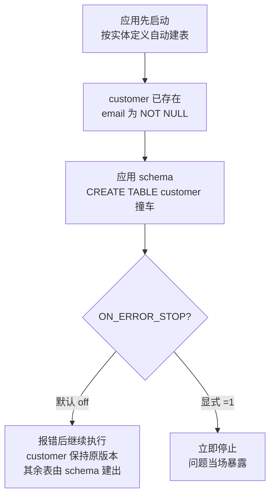

刚从 schema 文件建好的新库，验收时发现一列不对：schema 里明明是可空（nullable），库里却是 NOT NULL。图纸和现场对不上。这其实是一次典型的"静默失败"——那张表在"施工"之前就抢先存在了，而应用 schema 时的一行报错被默认跳过了。本文记录完整的溯源路径：怎么排除输入、怎么用 OID 读出表的"批次"、怎么用一行日志实锤，最后怎么把库带回正轨。

<!--more-->

## 一、症状：图纸和现场对不上

场景很普通：从原库导出 schema 文件，应用到一个全新的数据库。验收时发现——

```
schema 文件里:  email character varying(255)      -- 可空
数据库里查询:   email character varying NOT NULL   -- 有 NOT NULL
```

先把基本功列一下。查一列是否可空，三条路：

```sql
-- 1. information_schema（最好记）
SELECT column_name, is_nullable
FROM information_schema.columns
WHERE table_name = 'customer' AND column_name = 'email';
-- is_nullable: 'YES' = 可空，'NO' = NOT NULL

-- 2. pg_attribute（更底层）
SELECT attname, attnotnull
FROM pg_attribute
WHERE attrelid = 'customer'::regclass
  AND attname = 'email' AND attnum > 0;

-- 3. psql 快捷方式
\d customer
```

注意 schema 名：如果表不在 `search_path` 里，记得补 `table_schema` 条件，或写全 `schema.table`。

现在有两个候选解释：

1. schema 文件本身就有 NOT NULL——自己看漏了；
2. 这张表根本不是 schema 建的——它在应用 schema 之前就已经存在。

在动手查之前，先说说**一条死路**。

## 二、先关上"查创建时间"这扇门

最自然的想法是：查这张表的创建时间。如果早于建库，就说明它是提前存在的。

坏消息：**PostgreSQL 默认不记录对象的创建时间。** 系统目录里根本没有这个字段：

- `pg_class` 里没有 `created_at` 这种列；
- `pg_stat_user_tables` 只有 `last_autovacuum`、`last_analyze` 这类统计时间；
- `relfilenode` 是物理文件编号，不是时间；
- 文件系统的 mtime 只反映**最后一次**重写——`VACUUM FULL`、`REINDEX`、`TRUNCATE` 都会刷新它，而且云托管数据库通常根本没有服务器权限去 `stat`。

唯一能拿到准确创建时间的方式，是当时就开着 DDL 日志（`log_statement = 'ddl'`）或审计插件（pgaudit）——事后补不了。

所以绝对时间查不到。退而求其次：**相对顺序**。PostgreSQL 虽然没有"出生证明"，但每个对象都有一个分配序号——OID。这是下一节的事。

## 三、证据一：先检查图纸本身

排查的一般原则：**先排除输入**。在怀疑"表提前存在"之前，先确认 schema 文件里真的没有 NOT NULL。

不能只看 `CREATE TABLE` 那一段。`pg_dump` 完全可能把 NOT NULL 输出成单独的语句：

```sql
ALTER TABLE ONLY public.customer ALTER COLUMN email SET NOT NULL;
```

所以要**全文扫描**：

```bash
grep -n -i "email" schema.sql
```

**这里有一个我们实际踩过的坑**：几十张表的库里，"email"这个词到处都是——`email`、`user_email`、`notification_email`……grep 只给行号和片段，如果只看片段就下结论，很可能把**别的表**的 `email ... NOT NULL` 当成了目标表的。必须连上下文一起看：

```bash
grep -n -B 8 "CREATE TABLE public.customer" schema.sql   # 定位创建语句在哪
sed -n '1699,1715p' schema.sql                            # 直接读这一段定义
```

最终确认：`customer` 的建表语句里（第 1699 行），email 列就是 `character varying(255)`——**没有 NOT NULL**。

图纸是干净的。差异只能来自现场。

## 四、证据二：用 OID 读出表的"批次"

`CREATE TABLE` 执行时，PostgreSQL 会给这张表分配一个 OID（对象标识符），来源是一个**全局递增分配的计数器**（起始值 16384，之前的编号留给系统目录）。它单调递增、不因删除而回退——所以在同一个实例内，**OID 的大小顺序就近似于创建顺序**。

把库里所有表按 OID 排出来：

```sql
SELECT relname, oid
FROM pg_class
WHERE relnamespace = 'public'::regnamespace
  AND relkind = 'r'
ORDER BY oid;
```

输出（节选）：

```
customer                 16451
customer_login           16468
order_metrics            16478
customer_session         16490
customer_invite          16500
access_key               16513
payment_metrics          16525
catalog_item             16537
...
supplier                 16582
———— 断层 ————
order_metrics_archive    18878
notify_setting           18893
archive_orders_2025      18904
...
invoice                  19035
product                  19149
```

第一眼的读法：`customer` 的 OID 是 16451，比后面那一大批（188xx、189xx）小得多——"这张表建得早"。

**但这样读还不够，而且容易误导。** 正确的读法是看**批次**，不是看单点：

- 16451 → 16582 这一段，OID 间隔是 10~17，排布均匀（间隔不是 1，是因为每条 `CREATE TABLE` 还会连带消耗索引、序列、类型等对象的编号）——这是**同一批 DDL 连续创建**的指纹；
- 18878 之后是另一批，两批之间存在一段明显的空档（没有编号落在中间）。

由此得到的结论，比第一眼的读法精确得多：

> 不是"customer 一张表提前存在了"，而是"customer 和十几张表是**同一个批次的产物**"。

这个区别为什么重要？因为"一张表的异常"和"一整批表的异常"，**排查范围和修复方案完全不同**。前者想的是"谁手动建了这张表"；后者才会引向真正的问题：这一整批表是谁、什么时候、用什么方式建的？

关于 OID 推断的适用边界，两句话交代清楚：

- 单调性的前提是**没有回卷**（计数器涨到 2³² 才回卷，正常使用永远遇不到）、**不跨实例**比较；并发创建时编号会交错，但同一批次内的连续性是看得出来的。
- 它给出的是"批次和先后"的**强暗示**，不是数学证明。要钉死结论，还得有直接证据。

顺带一提，16451 这个值本身也有信息量：起始值是 16384，它距离起点只差几十个——说明这些对象的创建发生在库生命周期的极早期。

## 五、证据三：日志里的那行 ERROR

回到应用 schema 时的 psql 输出，翻出一行：

```
psql:schema.sql:1699: ERROR:  relation "customer" already exists
```

1699——正是 `CREATE TABLE public.customer` 所在的那一行。

机制到这里完全清晰了。**psql 默认不遇错停止**（等价于 `ON_ERROR_STOP=off`），而是打印错误、**继续执行后面的语句**。于是整个事故链条是：



最终交付的是一个**混血库**：一部分表来自应用启动时的自动建表，一部分来自 schema。而 `customer` 看起来"建好了"——其实从未被 schema 碰过。

这也和第四节看到的 OID 断层对上了：16xxx 那批先于 schema 应用而存在，18xxx、19xxx 那批才是 schema 建的。

三个独立证据，收敛在同一个解释上：

| 证据 | 单独看说明了什么 | 汇合后说明什么 |
|---|---|---|
| schema 文件里 email 无 NOT NULL | 图纸干净 | 差异只能来自"表不是 schema 建的" |
| OID 两段断层 | 库里存在两批对象 | "提前存在"的是一整批表，不是孤例 |
| 日志 already exists @1699 | 该建表语句被跳过 | 被跳过的正是这张表 |

一个好假设的标准是**能解释全部观察**。到这一步，三个证据都指向同一条链路，结论可以钉死了。

## 六、修复：把库带回 schema 的轨道

修复之前先想清楚一个前提：**这个库的验收标准是什么？** 如果标准是"完全由 schema 创建"，那么任何被抢先建的表都是待清除对象——不管它的列碰巧对不对。

三个层次的解法：

| 方案 | 动作 | 评价 |
|---|---|---|
| 只修这一列 | `ALTER TABLE ... ALTER COLUMN email DROP NOT NULL` | 🔧 打补丁。其他被提前建的表可能还有别的与 schema 不一致处，只是还没被发现 |
| 只删表重来 | `DROP TABLE` + 重放 schema | 🔧 不彻底。建表时可能还连带创建了枚举类型、序列等对象，删表不会带走它们，重放时会撞名 |
| 重建数据库 | 停应用 → 关自动建表 → 重建 → 重放 | ✅ 一步到位 |

推荐路径的完整顺序：

```bash
# 1. 停掉应用（先让"肇事者"停下）
# 2. 关掉 ORM 自动建表：
#    Hibernate/Spring: spring.jpa.hibernate.ddl-auto=none（或 validate）
#    TypeORM:          synchronize: false
#    Sequelize:        不要调用 sync()
# 3. 重建库
psql -d postgres -c "SELECT pg_terminate_backend(pid) FROM pg_stat_activity \
  WHERE datname='appdb' AND pid <> pg_backend_pid();"
psql -d postgres -c "DROP DATABASE appdb;"
psql -d postgres -c "CREATE DATABASE appdb;"
# 4. 应用 schema —— 强制遇错停止
psql -v ON_ERROR_STOP=1 -d appdb -f schema.sql
# 5. 验证
```

验证清单：

```sql
-- 5a. 列属性符合预期
SELECT is_nullable FROM information_schema.columns
WHERE table_name = 'customer' AND column_name = 'email';   -- 应为 YES
-- 5b. 重跑 OID 列表：这次应该只有一批，连续、无断层
```

**第 2 步是整条链路的胜负手**：不关掉自动建表，前面全白做——应用一重启，表又被建回来。

最后留一个诚实提醒。这个 case 里"表是应用 ORM 建的"这个归因，严格说只验证到"**表在 schema 应用之前已经存在**"。至于它是 ORM 建的、还是某种别的机制建的——那是从 OID 批次加行业惯例推出的**最可能解释**。最后一厘米的验证，是去翻应用的配置（搜 `ddl-auto` / `synchronize`）。这一步别省：**防复发措施是否有效，完全取决于这个归因成立**。如果你查完发现应用压根没开自动建表，说明还有别的机制在往库里偷偷建表，那就得接着往下追。

## 七、把方法带走

这类问题的通用名字叫"**执行成功，但状态不符**"——脚本 / 迁移 / schema 跑完了，目标对象却不是你预期的样子。排查框架可以固化成五步：

| 步骤 | 动作 | 本 case 对应 |
|---|---|---|
| 0 | 确认什么查不到，别在死路上耗时间 | PG 不记录创建时间 → 转向 OID |
| 1 | 排除输入：脚本 / 文件本身是否有问题，全文扫描不抽样 | grep 全文件，确认 schema 干净 |
| 2 | 间接证据定批次：OID 排序看断层 | 16xxx vs 18xxx 两批 |
| 3 | 直接证据实锤：日志 / 审计 | `already exists @1699` |
| 4 | 收敛检验：一个假设必须解释全部证据 | "静默跳过"同时解释三者 |

预防清单，四句话：

- `psql` 永远加 `-v ON_ERROR_STOP=1`（或干脆用迁移工具管理 schema）；
- 生产环境关掉 ORM 自动建表（`ddl-auto=validate` / `synchronize: false`）——DDL 应该只有迁移一条通道；
- 应用 schema 前，确认目标库是空的；
- 想长期拥有 DDL 记录：`event trigger` 记表 / `pgaudit` / `log_statement='ddl'`，三选一，早点开。

回到这个 case，最险的地方其实不是"表被提前建了"——而是**报错被静默跳过了**。如果 psql 当时停下，问题在应用 schema 的那一秒就会暴露，而不是等到验收。

更普遍地说：任何"执行成功"的报告，都值得再追一句——**它真的执行了吗，还是只是没有停下来？**
