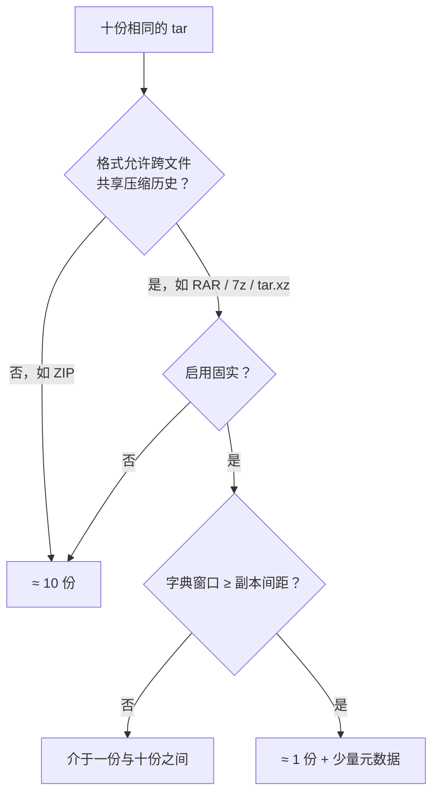

给同一个 tar 包复制十份、只改文件名，然后一起压缩——压缩包会是一份的大小，还是十份？这个问题没有唯一答案，但有一个干净的判据：**压缩器能不能「看见」前面那份数据**。而能不能看见，取决于三个变量：格式是否允许跨文件共享压缩历史、有没有启用固实压缩、字典窗口够不够大。把这三个变量拆开，你就能反过来用：按自己的场景主动选择压缩方式，而不是拿到什么用什么。

<!--more-->

## 一、结论先行：判据只有一条

十份内容完全相同、只有文件名不同的 tar，一起压缩：

```
压缩后 ≈ 1 份   ⟺  压缩器能「看见」前面那份数据
压缩后 ≈ 10 份  ⟺  看不见，每份都得从头压
```

而「能不能看见」要连过三关：



三关全过 → 一份；任何一关失败 → 十份；卡在第三关 → 中间地带。下面把每一关的机制讲清楚。

## 二、机制：压缩器是一个只有白板的抄写员

这一节讲原理，理解了它，后面所有工具的行为都能自己推导。

现代压缩（ZIP 的 deflate、RAR、7z 的 LZMA、xz、zstd）共享同一个核心思路，来自 LZ77：**发现重复，就不重写，改留批注。**

设想一个抄写员，手边只有一块小白板。他逐字节抄录内容，同时把最近抄过的内容记在白板上。一旦发现「这段和刚才某段一模一样」，就停下实抄，写一条批注：「回退 X 字节，复制 Y 字节」。原文里无论这段有多长，批注都只有几个字节。重复越多，省得越多。

这块白板，术语叫**字典窗口**（dictionary window）。它的容量决定抄写员能「回看」多远——超出白板范围的重复，他看不见，只能实抄。

现在十个相同 tar 摆在面前：

**非固实（每份单独压）**：抄完一个文件就擦一次白板。抄第二个 tar 时，它对第一个毫无记忆，只能实打实再抄一遍。压缩包 ≈ 10 份。

**固实（solid，所有文件当一个流连续压）**：白板一直不擦，十个 tar 被当成一篇文章连续抄。抄到第二个 tar 时，整份数据都能批注成「复制前面那一坨」——压缩包 ≈ 1 份。

第三关藏在细节里：**白板再大也是有限的。** 如果 tar 有 100MB，白板只有 16MB，抄到第二个 tar 开头时，第一个 tar 的开头已在 16MB 之外，够不着了——批注写不出来，只能继续实抄。所以跨份引用成立的条件是：

```
副本间距 ≤ 字典窗口
```

副本间距就是「第一个 tar 的开头到第二个 tar 的开头」的距离，约等于一个 tar 的大小。

还有一关是格式层面的硬性规定：**ZIP 格式在设计上要求每个文件是独立的压缩流**——相当于「规定每个文件抄完必须擦白板」。所以 ZIP **永远**非固实，就算把内部算法换成字典巨大的 LZMA 也一样。这一点常被混淆：很多人以为「ZIP 压不动跨文件重复是因为 deflate 窗口只有 32KB」，其实主因是格式隔离（条目之间根本没有引用机制），32KB 窗口只是叠加的次要限制——它连单个文件内部的远处重复都够不着。

最后补一个理论坐标：十份相同数据的真实信息量，本来就只有一份（外加十组文件名的元数据）。理论上，任何「能看见全部历史」的压缩器都能逼近这个下界；工程上达不到，只是因为要在「白板多大」和「记性多贵（内存、速度）」之间做取舍。

## 三、对号入座：各工具的默认行为

把三关套到常见工具上，直接得到结果。**注意「默认」二字——许多人感受到的工具差异，其实只是默认值差异。**

| 工具与格式 | 默认行为 | 十份相同 tar 的结果 | 原因 |
|---|---|---|---|
| ZIP / WinZip | 永远非固实 | ≈ 10 份 | 格式规定条目独立压缩流 |
| WinRAR（RAR 格式）| **默认非固实** | 默认 ≈ 10 份 | 固实需手动勾选「创建固实压缩文件」（或 `-s`） |
| WinRAR 开固实后 | 固实 | ≈ 1 份（字典够大时）| — |
| 7-Zip（7z 格式）| **默认固实** | ≈ 1 份（字典够大时）| 7z 默认把全部文件当一个流 |
| 7-Zip 压成 ZIP | 非固实 | ≈ 10 份 | 换了壳，仍受 ZIP 格式隔离 |
| tar.gz | 单流（相当于固实）| 大文件 ≈ 10 份；小文件可能 ≈ 1 份 | 全体共享一个流，但 deflate 窗口只有 32KB |
| tar.xz / tar.zst | 单流 + 大字典 | ≈ 1 份 | 字典可达数十 MB 级 |
| 分别压成十个包 | — | 总计 ≈ 10 份 | 包与包之间没有任何共享 |

两个值得单独记住的事实：

- **WinRAR 默认是非固实的。**「创建固实压缩文件」是一个要主动勾选的选项，命令行则要加 `-s`。直接右键压缩，得到的不是固实包。
- **7-Zip 的 7z 格式默认是固实的。** 这正是「7z 比 RAR 压得小」这个民间说法的来源之一：相当一部分差距只是默认值不同，而不是算法优劣。把 WinRAR 的固实勾上，差距会明显缩小。

## 四、字典不够大：介于一份与十份之间

跨份引用成立需要 `副本间距 ≤ 字典窗口`。代入数字：

- 十份 **10MB** 的 tar，间距 10MB。7-Zip 默认级别的字典（16MB 量级）够得着 → ≈ 1 份。
- 十份 **1GB** 的文件，间距 1GB。默认字典就够不着了——要手动把字典调到 GB 级。7-Zip 的字典可以按可用内存配置得很大；RAR 方面，RAR5 的字典上限是 1GB，而 RAR4 只有 4MB——用 RAR4 压大文件，开了固实也到不了「一份」。

所以「开了固实」不等于万事大吉，要**固实 + 字典 ≥ 数据尺度**一起看。这是很多人以为「固实没用」的真实原因：白板开了，但不够大。

## 五、嵌套一层：把十份再打成一个 tar 再压缩？

外层 tar 只是一个**拼接器**：它不压缩、不去重，只是把十个文件首尾相接（外加一些对齐和文件头）。所以外层 tar 本身必然变大，压缩后是大是小，回到同样三关：

- 7z / RAR 固实 + 字典足够大：后面九份被批注成「复制前面」→ ≈ 1 份
- ZIP / gzip，或字典太小：≈ 10 份

顺带清除一个常见误解：**对已经压缩过的数据「再压一遍」不会榨出更多**。已压缩数据接近随机，没有本地重复可利用。此时能变小的唯一来源是**跨副本引用**——十个相同的包互相当对方的「前面那份数据」。它能不能成功，还是看格式、固实、字典三关，与「二次压缩」本身无关。

## 六、反过来用：按场景选压缩方式

理解了机制，选择就不再靠猜。对照自己的场景：

| 你的场景 | 推荐 | 理由 |
|---|---|---|
| 长期归档大量相似文件（源码快照、文档库、虚拟机镜像）| 7z 固实 + 调大字典，或 tar.xz | 压缩率优先；解压慢、单文件抽取难可接受 |
| 归档内容需要频繁增删 | 非固实（ZIP，或 RAR 不勾固实）| 固实包改动一个文件就要重压整包 |
| 发给别人 | ZIP 最稳；确知对方环境再上 7z / RAR / tar.xz | 兼容性优先 |
| 跨版本备份、去重 | restic / borg 等去重工具 | 内容寻址相当于「无限历史的字典」，跨版本共享重复块，比固实压缩更强 |
| 压 JPEG / MP4 / 已压包 | 不必压 | 本来就没有冗余可挖 |

「固实包改动一个文件要重压整包」的原因可以从白板模型直接推出：固实包里所有批注的「回退距离」是相对整条连续流计算的，插入或替换一段数据，后面所有批注的坐标系全变了，只能从头重算。这也是固实包解压慢、损坏影响面大的根源——**省下来的体积，是用「局部性」换的**。

再往上一层看：压缩器的「白板」本质是一本有限的、只看最近历史的账；而去重工具（restic、borg）用内容哈希建索引，相当于一本**无限大**的账，且跨版本、跨文件夹生效。压缩和去重解决的是同一类问题的不同尺度，这也是备份圈「去重 > 压缩」说法的由来。

## 七、自己动手：三个十分钟实验

1. **对照默认值**：造一份 10MB 的随机数据打包成 tar，复制十份改名。分别用 ZIP 和 7z 压，比较两个包的大小——差出的那接近九倍，就是「固实」的贡献。
2. **测字典边界**：把同一组数据在 7-Zip 里换不同的字典大小（16MB / 256MB / 更大），观察结果从「一份」滑向「十份」或反向收敛的过程。
3. **比 tar.gz 与 tar.xz**：压同一个大目录，看 32KB 窗口和数十 MB 字典的区别。

一个留给你的开放问题：**你手上的数据，重复发生在哪个尺度上？** 是同一个文件内部的重复（窗口内就能吃到）、文件与文件之间的重复（需要固实）、还是版本与版本之间的重复（需要去重）？重复发生的尺度，决定你需要多大的「记性」——以及是不是该换个工具了。
