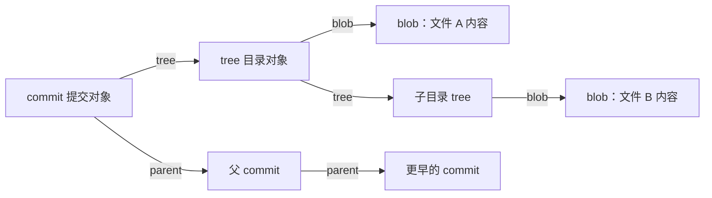

每次 `git log`，屏幕上那串 `a1b2c3d…` 总让人觉得是随机编号。其实它没有任何随机成分：它是 Git 对一份结构固定的文本——像一封电报——逐字节算出来的指纹。看懂这封电报，你就能一次性解释很多反直觉现象：为什么改提交信息会换 ID、为什么 rebase 后历史全变、为什么空提交也有 ID、为什么 Git 能发现历史被篡改。

<!--more-->

## 一、先把一次 commit 拆开看看

在你的仓库里执行：

```bash
git cat-file -p HEAD
```

会看到类似这样的内容：

```text
tree 4b825dc642cb6eb9a060e54bf8d69288fbee4904
parent 8c7e1f0a2b3c4d5e6f708192a3b4c5d6e7f80912
author Alice <alice@example.com> 1710000000 +0800
committer Alice <alice@example.com> 1710000000 +0800

fix: correct typo in README
```

这就是一次提交在 Git 数据库里的**真实存储内容**。它不是 JSON——没有花括号、没有引号、没有逗号；也不是某种二进制格式。它就是几行固定顺序的“字段 + 值”，加一个空行，再加提交信息正文。

| 字段 | 含义 |
|------|------|
| `tree` | 本次提交的目录快照，指向一个 tree 对象 |
| `parent` | 父提交的 ID；合并提交会有多行 |
| `author` | 作者身份与作者时间 |
| `committer` | 提交者身份与提交时间 |
| 空行之后 | 提交信息（message）正文 |

你可以把它想成一封**电报**：报头字段固定、顺序固定、用空格分隔；正文相对自由。电报不需要 JSON 那样的语法装饰，接收方按约定逐行解析即可。

## 二、Git 里不只有 commit

Git 有四种基本对象，各管一件事：

| 对象 | 存什么 |
|------|--------|
| `blob` | 一个文件的内容 |
| `tree` | 一层目录结构：文件名 → blob/tree 的指针 |
| `commit` | 一次快照：tree 指针 + 父提交 + 作者信息 + 提交信息 |
| `tag` | 附注标签的元数据 |

它们的关系是一棵树（更准确地说，是一个有向无环图）：



关键点：`tree` 和 `parent` 里存的是**哈希指针**，不是内容本身。就像电报里写“详见附件第 3 号”，而不是把附件全文抄一遍。文件内容由 blob 负责，目录结构由 tree 负责，历史关系由 commit 负责。

## 三、哈希到底是怎么算的

Git 存任何对象时，都会在内容前面加一层“信封”：

```text
<类型> <字节长度>\0<内容>
```

commit id 就是对这个完整字节序列做哈希（默认 SHA-1，新仓库可选 SHA-256）：

```text
commit id = SHA1("commit <长度>\0" + commit 对象字节)
```

你可以亲手验证：

```bash
git rev-parse HEAD
git cat-file commit HEAD | git hash-object -t commit --stdin
```

两条命令的输出**完全相同**。第二条命令做的就是：把 commit 对象的字节流重新交给 Git 算一遍哈希。

这也解释了为什么 ID 看起来像随机字符：SHA-1 的输出是 160 个比特，用十六进制写出来就是 40 个 `0-9a-f` 字符，本来就没有可读规律。哈希函数还有“雪崩效应”——输入改一个字节，输出面目全非。但请注意：**这是确定性的，不是随机的**。同样的输入，永远得到同样的输出。

## 四、三个新手最容易踩的误解

### 误解一：commit id 是随机生成的

不是。Git 生成 commit id 时没有调用任何随机数。它只是把 commit 对象的字节交给哈希函数。看起来随机，是因为哈希输出均匀分布，不代表输入随机。

### 误解二：时间戳保证 commit id 唯一

时间戳精确到**秒**。同一秒内完全可以产生多个提交。真正的唯一性来自整个 commit 对象的字节序列：tree、parent、author、committer、message 任何一处不同，ID 就不同。如果所有字段完全一致，两个提交的 ID 也会相同，Git 会把它们当作同一个对象。

### 误解三：commit id 是文件内容的哈希

文件内容的哈希由 blob 负责。commit 哈希的是“元数据 + 指针”：它记录了这次快照长什么样（tree）、历史从哪里来（parent）、谁在什么时候提交（author/committer）、以及提交信息。所以同一份代码，在不同时间、不同作者、不同父提交下，commit id 必然不同。

## 五、空提交为什么也有 ID

`git commit --allow-empty` 允许你创建一个“没有文件变更”的提交：它的 tree 和父提交的 tree 相同。

但它仍然有完整的 commit 对象：tree、parent、author、committer、message 一个不少。所以它仍然会被内容哈希，仍然有 ID。空提交不是“没有内容的提交”，只是“没有文件变更的提交”。

如果两个空提交的所有字段（包括时间）完全相同，它们的 ID 也会相同——Git 对象库会去重。

## 六、这套设计换来了什么

因为 commit id 是整份内容的指纹，而且 parent 也是指纹，Git 的历史天然形成一条**哈希链**（Merkle DAG）。由此可以解释很多日常现象：

| 现象 | 原因 |
|------|------|
| 改提交信息，ID 变了 | message 在哈希范围内 |
| `rebase` 后所有 ID 都变了 | parent 变了，committer 时间也变了，整条链重新计算 |
| 同一份代码在不同时间提交，ID 不同 | committer 时间戳不同 |
| Git 能发现历史被篡改 | 改任何一处，后续所有哈希都对不上 |
| 相同文件内容只存一份 | blob 按内容寻址，天然去重 |

这套机制叫**内容寻址**（content-addressed storage）：对象的名字就是它内容的指纹。名字不能撒谎——你无法在不改变名字的前提下修改内容。

## 七、五分钟动手实验

```bash
mkdir git-hash-lab && cd git-hash-lab
git init
git config user.name "Alice"
git config user.email "alice@example.com"

printf 'hello\n' > hello.txt
git add hello.txt
git commit -m "first commit"

# 1. 看 commit 对象的真实结构
git cat-file -p HEAD

# 2. 验证 ID 就是对象字节的哈希（两条输出应相同）
git rev-parse HEAD
git cat-file commit HEAD | git hash-object -t commit --stdin

# 3. 换一个 committer 时间，再做一个空提交
GIT_COMMITTER_DATE="2020-01-01T00:00:00 +0000" git commit --allow-empty -m "first commit"

# 4. 对比两次提交
git log --format='%H %ci %s'
```

你会看到：内容没变、message 没变，只是 committer 时间不同，commit id 就完全不同。

## 八、一句话模型

> **commit id = 对一封固定格式电报逐字节做哈希；报头里的 tree 和 parent，是指向其他电报的指纹。**

记住这个模型，Git 的很多“魔法”都会变成机械推论：改任何字段都会换 ID，换任何父提交都会换全链 ID，而“随机”从来都只是哈希输出的外观。

## 留给你的两个问题

1. 两个不同的仓库，做了完全相同的改动，它们的 commit id 会相同吗？动手造两个仓库验证一下，看看是哪些字段决定了答案。
2. SHA-1 已经被证明可以构造碰撞。那么 Git 的“不可篡改”还成立吗？Git 又是如何应对的？
